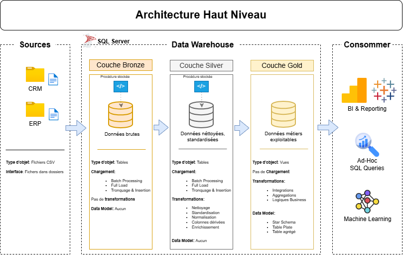
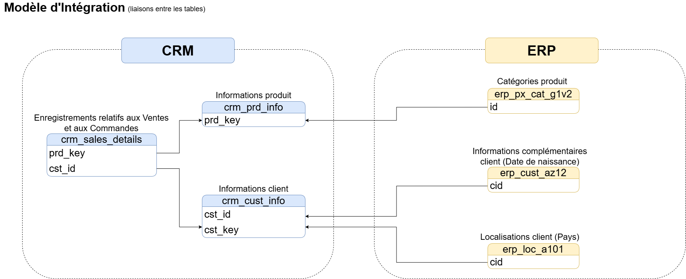
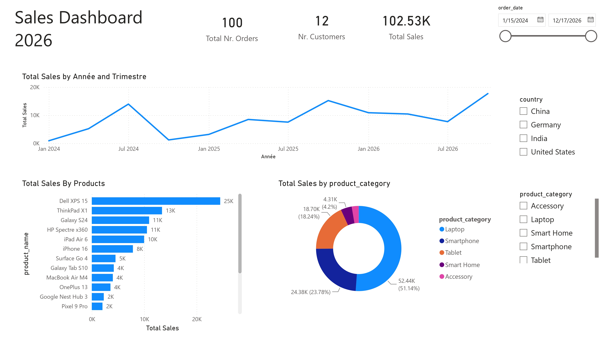
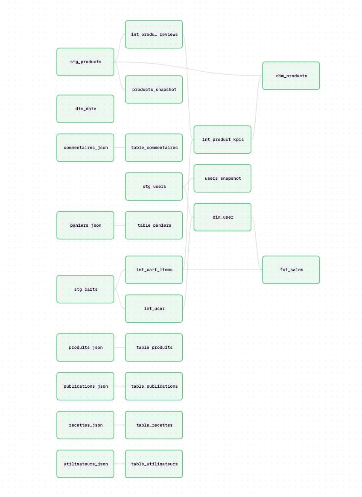
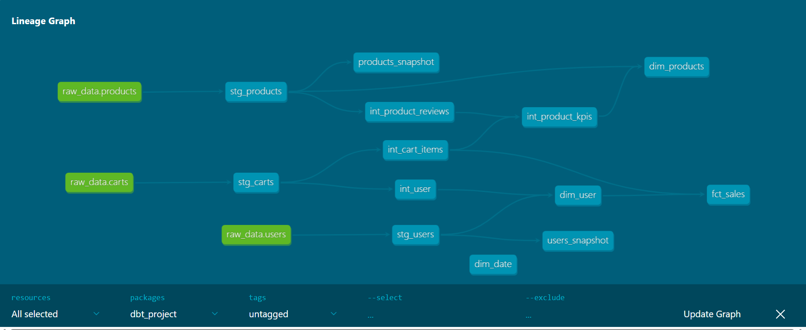

# Erwin DIDE — Recherche un stage de fin d'études

### Étudiant en dernière année de Master spécialisation Data

Bienvenue sur mon profil GitHub ! Je suis passionné par l'ingénierie des données, de la construction de systèmes pour collecter et traiter des données destinées à la prise de décision jusqu'à l'orchestration de pipelines complexes et le MLOps.

  
  <h1>Erwin DIDE</h1>
  
<b>Étudiant en dernière année de Master</b>

---

## Stack Technique & Compétences

| Domaine | Technologies & Outils |
| :--- | :--- |
| **Bases de données** | PostgreSQL, MySQL, DuckDB, MongoDB, Oracle |
| **Orchestration & ETL/ELT** | Airflow, Dagster, dbt, Talend |
| **Cloud & Storage** | GCP (BigQuery, Vertex AI), Distributed Systems (Hadoop, Kafka) |
| **MLOps & CI/CD** | MLflow, W&B, Docker, Kubernetes, GitHub Actions, GitLab CI, DVC |
| **Langages** | Python, SQL, Java, C |
| **Data Viz & BI** | Tableau, Power BI, Metabase, Streamlit |

---

## 📌 Projets à la une

###  Projet DataWarehouse et Analytics

####  🏗️ Architecture des données

L'architecture des données de ce projet suit une **architecture Médaillon** articulée autour des couches **Bronze**, **Silver** et **Gold** :

  

1. **Couche Bronze :** Stocke les données brutes telles quelles depuis les systèmes sources. Les données sont ingérées à partir de fichiers CSV vers une base de données SQL Server.
2. **Couche Silver :** Comprend les processus de nettoyage, de standardisation et de normalisation afin de préparer les données pour l'analyse.
3. **Couche Gold :** Héberge les données prêtes pour le métier, modélisées selon un schéma en étoile (*star schema*) requis pour le reporting et l'analytique.

####  🔗 Modèle d'intégration

Le diagramme suivant présente le modèle d'intégration des données et les relations entre les tables :

  

---

### 📊 [Dashboards & Analytics (Ventes & CRM)](https://public.tableau.com/app/profile/erwin.dide/vizzes)
> **Stack :** `Tableau`
- Conception de tableaux de bord interactifs pour l'analyse de performances multi-annuelles et l'aide à la décision business.
- *Découvrez mon dashboard interactif en ligne sur [Mon profil Tableau Public](https://public.tableau.com/app/profile/erwin.dide/vizzes).*

#### 📊 Tableau de bord interactif – Analyse des Ventes Multi-Années
> *(GitHub n'autorise pas l'intégration directe d'iframes ; cliquez sur le lien ci-dessous pour manipuler le tableau de bord en ligne)*  
> 👉 **[Ouvrir le dashboard interactif sur Tableau Public ↗](https://public.tableau.com/views/Projet_Dashboard_Ventes_Multi_Annees/SalesDashboard)**

---

### 📊 [Dashboards & Analytics - Power BI](https://github.com/ErwinDIDE)
> **Stack :** `Power BI` • `DAX` • `Modélisation de Données`
- Modélisation de données analytiques, création de mesures DAX et conception de rapports visuels interactifs.
- Analyse des ventes, suivi du volume de commandes et segmentation des clients.

#### 📊 Tableau de bord – Sales Dashboard 2026 (Power BI)

  
   
  <i>🛠️ Modélisation en étoile & mesures DAX développées sous Power BI Desktop</i>

---

### 📊 [E-Commerce Data Pipeline & Dashboard](https://github.com/ErwinDIDE)
> **Stack :** `Python` • `Streamlit` • `Dagster` • `dbt` • `Docker` • `REST API`
- Conception d'un pipeline ELT complet et d'un dashboard analytique pour le suivi de performances d'un site e-commerce :
  - **Ingestion & Extraction :** Collecte des données brutes (Produits, Utilisateurs, Commandes) depuis l'API *DummyJSON*.
  - **Orchestration :** Gestion du workflow et matérialisation des *Data Assets* avec **Dagster**.
  - **Modélisation & Data Warehousing :** Création des tables de faits et de dimensions (schéma en étoile) avec **dbt**.
  - **Visualisation & Conteneurisation :** Application interactive **Streamlit** pour piloter les KPIs analytiques, conteneurisée sous **Docker**.

#### 🏗️ Architecture & Modélisation du Pipeline

<table>
  <tr>
    <td align="center" width="50%">
      
       
      <i>Graphe d'orchestration & dépendances des Data Assets (Dagster)</i>
    </td>
    <td align="center" width="50%">
      
       
      <i>Modélisation décisionnelle en étoile - Star Schema (dbt / DuckDB)</i>
    </td>
  </tr>
</table>

#### 📊 Application – E-Commerce Analytics (Streamlit)
> 👉 **[Ouvrir l'application interactive Streamlit dans un nouvel onglet ↗](https://data-processingapp.streamlit.app)**

---

### 🚕 [Pipeline de Données Scalable (Taxi & Météo)](https://github.com/ErwinDIDE)
> **Stack :** `Spark` • `Flink` • `dbt` • `Airflow` • `Docker`
- Conception d'une architecture modulaire capable d'ingérer, stocker et transformer des données de trajets de taxis en temps réel croisées avec des conditions météo.
- Modélisation de données analytiques et orchestration bout en bout du pipeline.

---

### 💳 [Plateforme MLOps - Détection de Fraude Bancaire](https://github.com/ErwinDIDE)
> **Stack :** `Python` • `FastAPI` • `MLflow` • `W&B` • `XGBoost`
- Entraînement et optimisation d'un modèle de classification XGBoost sur des données Kaggle pour maximiser le rappel et la précision.
- Mise en place d'une API de prédiction performante via **FastAPI**.
- Tracking des expériences, versioning des modèles et suivi des métriques en temps réel sur **MLflow** & **W&B**.

---

## 🎓 Formation

- **Master d'Ingénierie — Spécialisation Data** | *SUPINFO* (2025 - 2027)
  - *Data Viz, Machine Learning (Vision, Classification, Réseaux de neurones), Admin DB & Systèmes Distribués.*

---

## 📬 Me contacter

- **📍 Localisation :** Rouen, France
- **📧 Email :** [didymedide0808@gmail.com](mailto:didymedide0808@gmail.com)
- **💼 LinkedIn :** [LinkedIn - Erwin DIDE](https://linkedin.com/in/erwin-dide)
- **📊 Tableau Public :** [Profil Tableau Public](https://public.tableau.com/app/profile/erwin.dide/vizzes)
